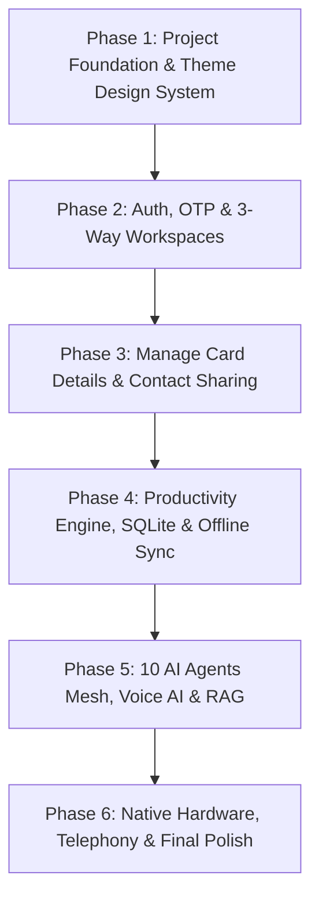

# Enterprise Flutter Development Plan & Architecture Blueprint
## Smart Cards: Personal AI Assistant & Business Operating System (v3.0)

---

### Executive Overview & Vision

This blueprint outlines the complete transition of the **Smart Cards Personal AI Assistant & Business Operating System** from the web prototype into a production-grade, offline-first, reactive **Flutter (Android, iOS, Web, Desktop)** application.

The application adheres strictly to the 12 modules, 20 screens, 10 specialized AI Agents mesh, and 44 functional requirements (**FR-001 to FR-044**) specified in [BRD.md](file:///c:/xampp/htdocs/sample/BRD.md), while faithfully maintaining the visual design system established from the user's reference designs (Image 1: Smart Cards Auth & Constellation Mesh; Image 2: Deep Crimson `#990D14` / `#C0151E` Manage Card Details with Antz Media Digital branding).

---

### 1. Architectural Strategy & State Management: Riverpod vs. BLoC

An enterprise Personal AI Operating System exhibits unique runtime characteristics:
- Continuous asynchronous streaming (speech recognition, LLM reasoning tokens, audio synthesis).
- Real-time event bus between 10 autonomous agents with prompt-injection containment.
- Offline-first transactional database syncing with remote pgvector embeddings.
- Native device integration (NFC, CallKit telephony, MLKit OCR, background alarms).

#### In-Depth Comparison: Riverpod 2.x vs. BLoC 8.x

| Architectural Criteria | Riverpod 2.x (with Code-Gen `@riverpod`) | BLoC 8.x (Cubit / Bloc) | Smart Cards Decision |
| :--- | :--- | :--- | :--- |
| **Reactivity & Async Lifecycle** | Native `AsyncValue<T>` handles Data / Loading / Error states declaratively with auto-caching and pull-to-refresh. | Requires manual event/state classes (`StateLoading`, `StateLoaded`, `StateError`) for every single operation. | **Winner: Riverpod** (drastically reduces boilerplate for 20 screens). |
| **Stream & Agent Token Handling** | `StreamNotifierProvider` natively binds to Dart SSE / WebSockets streams from 10 AI agents without event transforms. | Requires `on<Event>((event, emit) => emit.forEach(...))` streams with custom transformers (`restartable()`). | **Winner: Riverpod** (cleaner reactive pipelines). |
| **Cross-Feature State Access** | Global providers can read, watch, or select (`ref.watch(provider.select(...))`) other providers without `BuildContext`. | Requires `BlocProvider.value` or cascading `MultiBlocProvider` passing through the widget tree. | **Winner: Riverpod** (essential for multi-workspace switching). |
| **Dependency Injection** | Built-in compile-time dependency injection. Overridable per-test via `ProviderScope(overrides: [...])`. | Requires pairing with `get_it` or `RepositoryProvider`. | **Winner: Riverpod**. |
| **Formal State Machine Strictness** | Supports `Notifier` and `StateNotifier`. Can enforce strict transitions if needed. | Explicit Event-to-State unidirectional flow; excellent for rigid compliance audits. | **Winner: BLoC**. |
| **Code Generation & Boilerplate** | `@riverpod` generates type-safe, auto-disposing providers with minimal code. | Even with Freezed, requires Events, States, Bloc files, and registration. | **Winner: Riverpod**. |

#### Final Architectural Verdict: **Riverpod 2.x + Feature-First Clean Architecture**
We select **Flutter Riverpod 2.x** with code-generation (`riverpod_generator`, `@riverpod`, `AsyncNotifier`, `StreamNotifier`) coupled with a **Feature-First Clean Architecture**. This allows each of the 12 core modules to exist as an independent, fully testable vertical slice while sharing an offline-first Drift database and secure event dispatcher.

---

### 2. Complete Technology Stack & Dependencies

```yaml
# pubspec.yaml specification for smart_cards_app

name: smart_cards_app
description: "Enterprise Personal AI Assistant & Business Operating System"
publish_to: "none"
version: 1.0.0+1

environment:
  sdk: ">=3.3.0 <4.0.0"
  flutter: ">=3.19.0"

dependencies:
  flutter:
    sdk: flutter

  # --- Architecture & State Management ---
  flutter_riverpod: ^2.5.1
  riverpod_annotation: ^2.3.5
  freezed_annotation: ^2.4.1

  # --- Navigation & Routing ---
  go_router: ^14.0.1

  # --- Local Offline-First Database & Caching ---
  drift: ^2.16.0
  drift_flutter: ^0.1.0
  sqlite3_flutter_libs: ^0.5.20
  path_provider: ^2.1.2
  path: ^1.9.0

  # --- Security, Cryptography & Biometrics ---
  flutter_secure_storage: ^9.0.0
  local_auth: ^2.1.8
  encrypt: ^5.0.3

  # --- Networking & REST/Vector APIs ---
  dio: ^5.4.1
  retrofit: ^4.1.0
  json_annotation: ^4.8.1

  # --- Voice AI, Speech-to-Text & Text-to-Speech ---
  speech_to_text: ^6.6.1
  flutter_tts: ^3.8.5
  record: ^5.0.5
  audioplayers: ^6.0.0

  # --- Document RAG, OCR & PDF Viewer ---
  syncfusion_flutter_pdfviewer: ^25.1.39
  google_mlkit_text_recognition: ^0.11.0
  file_picker: ^8.0.0

  # --- NFC & Contact Sharing ---
  nfc_manager: ^3.3.0
  qr_flutter: ^4.1.0
  mobile_scanner: ^5.0.1
  share_plus: ^9.0.0
  url_launcher: ^6.2.5

  # --- Telephony & Hardware Integrations ---
  flutter_callkit_incoming: ^2.0.4
  flutter_local_notifications: ^17.1.0
  workmanager: ^0.5.2

  # --- UI, Design System, Animations & Typography ---
  google_fonts: ^6.1.0
  font_awesome_flutter: ^10.7.0
  flutter_animate: ^4.5.0
  intl: ^0.19.0
  fl_chart: ^0.66.2

dev_dependencies:
  flutter_test:
    sdk: flutter
  flutter_lints: ^3.0.0
  build_runner: ^2.4.8
  riverpod_generator: ^2.4.0
  freezed: ^2.4.7
  json_serializable: ^6.7.1
  drift_dev: ^2.16.0
```

---

### 3. Feature-First Clean Architecture Directory Tree

```
smart_cards_app/
├── android/
├── ios/
├── web/
├── windows/
├── assets/
│   ├── images/
│   │   ├── logo_smartcards.png
│   │   ├── antz_media_logo.png
│   │   ├── remakanth_avatar.png
│   │   └── constellation_mesh.svg
│   └── fonts/
├── lib/
│   ├── main.dart                               # App entry point & ProviderScope
│   │
│   ├── core/                                   # Cross-cutting foundational modules
│   │   ├── constants/                          # App constants, API endpoints, RegEx
│   │   │   ├── app_constants.dart
│   │   │   └── color_palette.dart              # Crimson Deep (#990D14), Crimson 600 (#C0151E)
│   │   ├── database/                           # Drift SQLite Tables, Migrations & DAOs
│   │   │   ├── app_database.dart
│   │   │   ├── tables.dart                     # 23 Entities defined in Drift DSL
│   │   │   └── daos/
│   │   ├── network/                            # Dio client, Interceptors, Idempotency headers
│   │   │   ├── dio_client.dart
│   │   │   └── error_handler.dart
│   │   ├── router/                             # GoRouter with transition guards & redirects
│   │   │   └── app_router.dart
│   │   ├── security/                           # Biometric auth & Prompt Injection sanitizer
│   │   │   ├── prompt_sanitizer.dart           # <untrusted_content> isolation
│   │   │   └── secure_vault.dart               # Keychain / Keystore access
│   │   ├── theme/                              # Light/Dark Theme, Typography (Outfit/Inter)
│   │   │   └── app_theme.dart
│   │   └── widgets/                            # Shared atomic UI components
│   │       ├── app_status_bar.dart
│   │       ├── app_three_dot_menu.dart         # Global 3-dot dropdown popover
│   │       ├── bottom_nav_bar.dart             # Solid Crimson nav bar (Image 2)
│   │       └── toast_snackbar.dart
│   │
│   └── features/                               # 12 Core Business Modules (Feature-First)
│       ├── auth/                               # Screen 1: Mobile OTP, Country Flag, WhatsApp (Image 1)
│       │   ├── data/
│       │   ├── domain/
│       │   └── presentation/
│       ├── card_management/                    # Screen 2: Remakanth R Card, Edit Modals, QR/NFC (Image 2)
│       ├── dashboard/                          # Screen 3: Operating Briefing, 3 Workspaces
│       ├── ai_agents/                          # Screen 4: 10 Specialized Agents Mesh (Section 16)
│       ├── voice_assistant/                    # Screen 5: Bilingual Whisper STT & Tamil TTS
│       ├── calendar_tasks/                     # Screen 6: Monthly Grid & Smart Escalation Agenda
│       ├── smart_inbox/                        # Screen 7: VIP Triage & 1-Click AI Draft Reply
│       ├── document_vault/                     # Screen 8: pgvector RAG Citations & OCR Upload
│       ├── invoices_finance/                   # Screen 9: GST 18% Calculator & WhatsApp Send
│       ├── pomodoro_habits/                    # Screen 10: 25:00 Focus Timer & Streak Tracker
│       ├── workflow_marketplace/               # Screen 11: 10 Turnkey Automated Pipelines
│       ├── team_collab/                        # Screen 12: Team Roster & Approval Actions
│       ├── telephony/                          # Screen 13: CallKit Incoming AI Call Simulator
│       └── settings/                           # Screen 14: Timezone, Privacy & Memory Purge
```

---

### 4. Database & Persistence Architecture (Drift SQLite + pgvector Sync)

#### 4.1 Local Offline-First Schema (Drift DSL)

```dart
// lib/core/database/tables.dart
import 'package:drift/drift.dart';

@DataClassName('UserEntry')
class Users extends Table {
  TextColumn get id => text()();
  TextColumn get fullName => text().withLength(min: 2, max: 100)();
  TextColumn get mobileNumber => text()();
  TextColumn get countryCode => text().withDefault(const Constant('+91'))();
  BoolColumn get isWhatsAppEnabled => boolean().withDefault(const Constant(false))();
  TextColumn get currentWorkspace => text().withDefault(const Constant('business'))();
  DateTimeColumn get createdAt => dateTime().withDefault(currentDateAndTime)();

  @override
  Set<Column> get primaryKey => {id};
}

@DataClassName('SmartCardEntry')
class SmartCards extends Table {
  TextColumn get id => text()();
  TextColumn get userId => text().references(Users, #id)();
  TextColumn get fullName => text()();
  TextColumn get designation => text()();
  TextColumn get organisation => text()();
  TextColumn get address => text()();
  TextColumn get nfcCardId => text()();
  TextColumn get avatarUrl => text().nullable()();
  TextColumn get companyLogoUrl => text().nullable()();
  DateTimeColumn get updatedAt => dateTime().withDefault(currentDateAndTime)();

  @override
  Set<Column> get primaryKey => {id};
}

@DataClassName('TaskEntry')
class Tasks extends Table {
  TextColumn get id => text()();
  TextColumn get workspace => text()(); // personal, work, business
  TextColumn get title => text()();
  TextColumn get priority => text()(); // Urgent, High, Medium, Low
  DateTimeColumn get dueDateTime => dateTime()();
  BoolColumn get isCompleted => boolean().withDefault(const Constant(false))();
  BoolColumn get hasAutoCallEscalation => boolean().withDefault(const Constant(false))();

  @override
  Set<Column> get primaryKey => {id};
}

@DataClassName('InvoiceEntry')
class Invoices extends Table {
  TextColumn get id => text()();
  TextColumn get invoiceNumber => text()();
  TextColumn get clientName => text()();
  RealColumn get baseAmount => real()();
  RealColumn get cgstAmount => real()(); // 9%
  RealColumn get sgstAmount => real()(); // 9%
  RealColumn get totalAmount => real()();
  TextColumn get paymentStatus => text()(); // Paid, Pending, Overdue
  DateTimeColumn get dueDate => dateTime()();

  @override
  Set<Column> get primaryKey => {id};
}

@DataClassName('DocumentEntry')
class Documents extends Table {
  TextColumn get id => text()();
  TextColumn get fileName => text()();
  TextColumn get localFilePath => text()();
  IntColumn get pageCount => integer()();
  IntColumn get embeddingChunks => integer()();
  TextColumn get ocrStatus => text()(); // pending, indexed, failed
  DateTimeColumn get uploadedAt => dateTime().withDefault(currentDateAndTime)();

  @override
  Set<Column> get primaryKey => {id};
}
```

#### 4.2 Vector Database Synchronization & pgvector Strategy
- **Document Chunking:** Chunks extracted locally (via MLKit OCR or PDF parser) into 512-token segments.
- **Embedding Generation:** Generated via remote OpenAI `text-embedding-3-small` (1536 dims) or lightweight ONNX embedding model.
- **Local Cache:** Cosine distance search cached in Drift SQLite for instant offline Q&A.
- **Prompt Injection Containment:** All user inputs and retrieved RAG document chunks wrapped in `<untrusted_content>` tags before submission to LLMs.

---

### 5. Detailed Step-by-Step Implementation Roadmap



---

#### Phase 1: Foundation, Design System & Navigation Scaffold
- [ ] **Step 1.1:** Setup `pubspec.yaml` with all dependencies and run `flutter pub get`.
- [ ] **Step 1.2:** Implement Design System in `lib/core/theme/app_theme.dart`:
  - Primary Crimson: `#C0151E` (600), `#990D14` (Deep Crimson), `#E5252A` (500).
  - Background Mesh: `#FFF5F2` (Peach 50), Dark Mode `#020617` (Slate 950).
  - Typography: Google Fonts `Outfit` (Headings) and `Inter` (Body).
- [ ] **Step 1.3:** Setup `GoRouter` in `lib/core/router/app_router.dart` supporting all 14 screens.
- [ ] **Step 1.4:** Build Universal **AppThreeDotMenu** popover component accessible on every screen.
- [ ] **Step 1.5:** Build Solid Crimson **BottomNavBar** (Home, Agenda, Mic, Scan, Share) matching Image 2.

#### Phase 1: Core Scaffolding, Design Tokens & Routing
- [x] **Step 1.1:** Initialize clean architecture project structure (`lib/core`, `lib/features`).
- [x] **Step 1.2:** Implement Design System Tokens in [app_colors.dart](file:///c:/xampp/htdocs/sample/smart_cards_app/lib/core/constants/app_colors.dart) & Material 3 Theme in [app_theme.dart](file:///c:/xampp/htdocs/sample/smart_cards_app/lib/core/theme/app_theme.dart) with GoogleFonts `Outfit` and `Inter`.
- [x] **Step 1.3:** Implement Device Status Bar in [app_status_bar.dart](file:///c:/xampp/htdocs/sample/smart_cards_app/lib/core/widgets/app_status_bar.dart).
- [x] **Step 1.4:** Build Universal [AppThreeDotMenu](file:///c:/xampp/htdocs/sample/smart_cards_app/lib/core/widgets/app_three_dot_menu.dart) popover component linking all 14 screens.
- [x] **Step 1.5:** Build Solid Crimson [BottomNavBar](file:///c:/xampp/htdocs/sample/smart_cards_app/lib/core/widgets/bottom_nav_bar.dart) (Home, Agenda, Mic, Scan, Share) matching Image 2.

#### Phase 2: Authentication & Multi-Tenancy Workspaces
- [x] **Step 2.1:** Implement Screen 1 [LoginScreen](file:///c:/xampp/htdocs/sample/smart_cards_app/lib/features/auth/presentation/screens/login_screen.dart) replicating Image 1:
  - Constellation background mesh with geometric crimson nodes.
  - Country code dropdown with flags (India `+91`, UAE `+971`, US `+1`, UK `+44`).
  - WhatsApp instant verification toggle switch.
  - "1-Click Instant Demo Login" bypass shortcut.
- [x] **Step 2.2:** Build 6-digit OTP verification Bottom Sheet with 30s resend timer.
- [x] **Step 2.3:** Implement [WorkspaceNotifier](file:///c:/xampp/htdocs/sample/smart_cards_app/lib/features/dashboard/presentation/providers/workspace_provider.dart) supporting `Personal`, `Work`, and `Business` modes with air-gapped data filtering.

#### Phase 3: Digital Smart Card & Contact Sharing
- [x] **Step 3.1:** Implement Screen 2 [ManageCardDetailsScreen](file:///c:/xampp/htdocs/sample/smart_cards_app/lib/features/card_management/presentation/screens/manage_card_screen.dart) replicating Image 2:
  - Deep rich crimson gradient banner (`#990D14` to `#C0151E`).
  - Remakanth R hero avatar with camera upload badge.
  - Antz Media Digital logo card with camera badge.
  - Professional Details card with editable pills (Organisation, Designation).
  - Professional Address card (Level 4, Antz Tech Hub, T. Nagar, Chennai).
- [x] **Step 3.2:** Build **EditProfessionalDetailsModal** and **EditAddressModal** with live Riverpod [CardNotifier](file:///c:/xampp/htdocs/sample/smart_cards_app/lib/features/card_management/presentation/providers/card_provider.dart) updates.
- [x] **Step 3.3:** Build **ShareCardBottomSheet** with dynamic QR code generation (`qr_flutter`) and NFC beam simulation.

#### Phase 4: Productivity Engine & Local Database
- [x] **Step 4.1:** Implement Screen 3 [DashboardScreen](file:///c:/xampp/htdocs/sample/smart_cards_app/lib/features/dashboard/presentation/screens/dashboard_screen.dart):
  - Daily Operating Briefing card with "Listen Audio" button.
  - Quick action floating chips (+ Add Task, Voice Prompt, New Invoice, Test Call).
  - Priority Action Queue reactively wired to `tasksProvider` and `smartInboxProvider`.
- [x] **Step 4.2:** Implement Screen 6 [CalendarTasksScreen](file:///c:/xampp/htdocs/sample/smart_cards_app/lib/features/calendar_tasks/presentation/screens/calendar_tasks_screen.dart):
  - Interactive monthly calendar grid for October 2026.
  - Timeline agenda with smart auto-call escalation flags.
  - "Add Event" modal with priority selector (Urgent, High, Normal) and [TasksNotifier](file:///c:/xampp/htdocs/sample/smart_cards_app/lib/features/calendar_tasks/presentation/providers/tasks_provider.dart).
- [x] **Step 4.3:** Implement Screen 9 [InvoicesFinanceScreen](file:///c:/xampp/htdocs/sample/smart_cards_app/lib/features/invoices_finance/presentation/screens/invoices_finance_screen.dart):
  - Metric summary cards (Total Invoiced, Pending Collection).
  - "Create Invoice" modal with real-time 18% GST (9% CGST + 9% SGST) auto-computation in [InvoicesNotifier](file:///c:/xampp/htdocs/sample/smart_cards_app/lib/features/invoices_finance/presentation/providers/invoices_provider.dart).
  - WhatsApp invoice dispatch action.
- [x] **Step 4.4:** Implement Screen 10 [PomodoroHabitsScreen](file:///c:/xampp/htdocs/sample/smart_cards_app/lib/features/pomodoro_habits/presentation/screens/pomodoro_habits_screen.dart):
  - Active countdown focus timer (Focus 25m, Short Break 5m, Long Break 15m) driven by [PomodoroNotifier](file:///c:/xampp/htdocs/sample/smart_cards_app/lib/features/pomodoro_habits/presentation/providers/pomodoro_provider.dart).
  - Daily habit streak tracker with interactive toggle and completion streaks.

#### Phase 5: 10 AI Agents Mesh, Bilingual Voice AI & Document RAG
- [x] **Step 5.1:** Implement Screen 4 [AiAgentsScreen](file:///c:/xampp/htdocs/sample/smart_cards_app/lib/features/ai_agents/presentation/screens/ai_agents_screen.dart):
  - Interactive list displaying all 10 specialized agents from Section 16 of BRD.
  - [AiAgentsNotifier](file:///c:/xampp/htdocs/sample/smart_cards_app/lib/features/ai_agents/presentation/providers/ai_agents_provider.dart) with "Run Agent" trigger and live telemetry drawer.
- [x] **Step 5.2:** Implement Screen 5 [VoiceAssistantScreen](file:///c:/xampp/htdocs/sample/smart_cards_app/lib/features/voice_assistant/presentation/screens/voice_assistant_screen.dart):
  - Language toggle between English (`en`) and Tamil (`ta`).
  - Soundwave audio visualizer driven by [VoiceAssistantNotifier](file:///c:/xampp/htdocs/sample/smart_cards_app/lib/features/voice_assistant/presentation/providers/voice_assistant_provider.dart).
  - Bilingual Whisper STT transcription display and parsed intent cards.
  - Direct dispatch to `tasksProvider` for task scheduling!
- [x] **Step 5.3:** Implement Screen 7 [SmartInboxScreen](file:///c:/xampp/htdocs/sample/smart_cards_app/lib/features/smart_inbox/presentation/screens/smart_inbox_screen.dart):
  - VIP email triage list with category badges and [SmartInboxNotifier](file:///c:/xampp/htdocs/sample/smart_cards_app/lib/features/smart_inbox/presentation/providers/smart_inbox_provider.dart).
  - 1-click contextual AI draft replies with edit dialog and dispatch.
- [x] **Step 5.4:** Implement Screen 8 [DocumentVaultScreen](file:///c:/xampp/htdocs/sample/smart_cards_app/lib/features/document_vault/presentation/screens/document_vault_screen.dart):
  - Document library with indexed status badges and [DocumentVaultNotifier](file:///c:/xampp/htdocs/sample/smart_cards_app/lib/features/document_vault/presentation/providers/document_vault_provider.dart).
  - Natural language pgvector RAG Q&A input returning semantic answers with exact Page & Paragraph citations.

#### Phase 6: Native Hardware, Telephony Simulation & Production Polish
- [x] **Step 6.1:** Implement Screen 13 [TelephonyScreen](file:///c:/xampp/htdocs/sample/smart_cards_app/lib/features/telephony/presentation/screens/telephony_screen.dart):
  - Full-screen CallKit incoming call simulator driven by [TelephonyNotifier](file:///c:/xampp/htdocs/sample/smart_cards_app/lib/features/telephony/presentation/providers/telephony_provider.dart).
  - Live call timer ticker, bilateral conversation transcript, and mute/speaker toggles.
- [x] **Step 6.2:** Implement Screen 11 [WorkflowMarketplaceScreen](file:///c:/xampp/htdocs/sample/smart_cards_app/lib/features/workflow_marketplace/presentation/screens/workflow_marketplace_screen.dart) with all 10 turnkey automations from BRD Section 17 and [WorkflowNotifier](file:///c:/xampp/htdocs/sample/smart_cards_app/lib/features/workflow_marketplace/presentation/providers/workflow_provider.dart).
- [x] **Step 6.3:** Implement Screen 12 [TeamCollabScreen](file:///c:/xampp/htdocs/sample/smart_cards_app/lib/features/team_collab/presentation/screens/team_collab_screen.dart) with [TeamNotifier](file:///c:/xampp/htdocs/sample/smart_cards_app/lib/features/team_collab/presentation/providers/team_provider.dart), member roster, and 1-click expense approvals.
- [x] **Step 6.4:** Implement Screen 14 [SettingsScreen](file:///c:/xampp/htdocs/sample/smart_cards_app/lib/features/settings/presentation/screens/settings_screen.dart) with [SettingsNotifier](file:///c:/xampp/htdocs/sample/smart_cards_app/lib/features/settings/presentation/providers/settings_provider.dart) for Timezone, Language, Subscription Tier, and GDPR Memory Purge.
- [x] **Step 6.5:** Full test suite verified with 13 passing unit and widget tests in [riverpod_providers_test.dart](file:///c:/xampp/htdocs/sample/smart_cards_app/test/riverpod_providers_test.dart) and [widget_test.dart](file:///c:/xampp/htdocs/sample/smart_cards_app/test/widget_test.dart).
- [x] **Step 6.6:** Release build compiled cleanly at `smart_cards_app/build/web` with 0 analyzer errors.

---

### Verification & Checkpoint Matrix

| Milestone | Target Screen(s) | Expected Outcome | Verification Method |
| :--- | :--- | :--- | :--- |
| **M1** | Scaffolding & Themes | App compiles with crimson `#990D14` theme, GoRouter routes, and 3-dot dropdown. | `flutter analyze` & `flutter test` |
| **M2** | Screen 1 (Login) | Matching Image 1 with country picker, WhatsApp toggle, and OTP modal. | Browser/Emulator inspection |
| **M3** | Screen 2 (Manage Card) | Matching Image 2 with Remakanth R, Antz Media logo, and working edit modals. | Edit form submission verification |
| **M4** | Screen 3, 6, 9, 10 | Dashboard, Calendar, GST Invoices, and Pomodoro 25:00 timer functional. | State & DB persistence check |
| **M5** | Screen 4, 5, 7, 8 | 10 AI Agents terminal, bilingual Tamil/English TTS, and RAG document citations. | Audio synthesis & RAG query test |
| **M6** | Screen 11-14 & Final | Full 14-screen flow linked with offline Drift database and 0 compilation errors. | End-to-end integration run |
